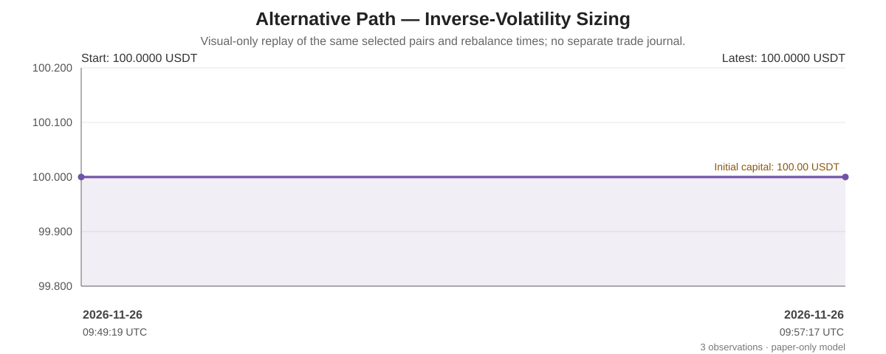

# ACTIVE PAPER STATUS — BAB $100 USDT

**🟢 ACTIVE · PAPER ONLY · NO LIVE ORDERS**

**Correct workflow:** [Open active workflow](https://github.com/takenthatusernameis-collab/Crypto-Betting-Against-Beta/actions/workflows/bab-paper-cycle.yml)

- Account: `mexc-usdt-forward-bab-100usdt-v1`
- Strategy generation: `crypto-bab-low-beta-long-high-beta-short-v1`
- Starting capital: **100.00000000 USDT**
- Account state: **INITIALIZED — FORWARD PAPER**
- Last report build: 2026-11-28 18:22:31 UTC
- Latest workflow run: [46175428248](https://github.com/takenthatusernameis-collab/Crypto-Betting-Against-Beta/actions/runs/46175428248) · run #19, attempt 1 · success · schedule
- Latest processed daily candle: 2026-11-27 00:00:00 UTC
- Latest account event: 2026-11-28 18:22:18 UTC
- Primary execution journal: [PAPER_TRADE_JOURNAL.md](PAPER_TRADE_JOURNAL.md)

## MEXC market-data coverage

- Coverage state: **VERIFIED — SNAPSHOT ONLY**
- Active USDT-settled trading contracts: 1090
- Contracts with at least 60 aligned daily beta returns: 902
- Contracts excluded for insufficient rolling history: 188
- Latest completed daily bar (UTC ms): 1795737600000
- Portfolio decision status: `MONITORING_ONLY_NO_STRATEGY_DECISIONS`

The complete eligible USDT universe is evaluated through the rolling-history gate at each daily decision. Snapshot-only runs reuse the last verified daily gate and do not recompute the ranking.
The portfolio remains a paper simulation; all fills are simulated and no exchange orders are submitted.
## Current performance

| Metric | Value |
|---|---:|
| Initial capital | 100.00000000 USDT |
| **NAV** | **105.76724620 USDT** |
| Total return | +5.767% |
| Cash | 101.01924620 USDT |
| Unrealized P&L | +4.74800000 USDT |
| Fees paid | 0.14975380 USDT |
| Confirmed funding | +0.00000000 USDT |
| Gross exposure | 1.384× NAV |
| Net exposure | 0.354× NAV |
| Current drawdown from risk-window peak | +0.000% |
| Lifetime / cross-session maximum drawdown | -19.604% |
| Worst risk-session maximum drawdown | -15.927% |
| Sharpe ratio | Unavailable — At least 30 daily returns are required |
| Sortino ratio | Unavailable — Requires at least 20 daily returns and 5 negative daily returns |
| Annualized daily volatility | Unavailable — At least 30 daily returns are required |

### Maximum drawdown by risk session

| Session start (UTC) | Starting NAV | Latest NAV | Max drawdown | Marks |
|---|---:|---:|---:|---:|
| 2026-11-26 00:00:00 UTC | 100.00000000 | 100.00000000 | +0.000% | 9 |
| 2026-11-26 22:22:32 UTC | 99.86839680 | 99.78739680 | -0.081% | 1 |
| 2026-11-27 00:00:00 UTC | 95.38639680 | 95.38639680 | +0.000% | 1 |
| 2026-11-27 02:20:07 UTC | 95.62560740 | 88.96560740 | -15.927% | 3 |
| 2026-11-28 00:00:00 UTC | 101.49560740 | 101.49560740 | +0.000% | 1 |
| 2026-11-28 02:19:14 UTC | 100.88824620 | 105.76724620 | +0.000% | 3 |

## Open positions

| Symbol | Side | Quantity | Entry price | Mark | Notional (USDT) |
|---|---|---:|---:|---:|---:|
| SOXS_USDT | long | 1 | 53.93 | 54.44 | 54.440000 |
| USELESS_USDT | short | 1300 | 0.07396 | 0.0707 | 91.910000 |

## Primary path — equal exposure

The live forward-paper strategy sizes the long and short legs independently toward equal USDT notional (approximately 1× NAV per leg before lot rounding).

## Alternative path — volatility-weighted sizing

This chart is a **visual-only counterfactual**, not an executed account. It reuses the primary strategy’s exact selected symbols, sides and rebalance timestamps; only the notional split changes. No alternative trade journal is created.

At each rebalance, the quieter leg receives the larger share using inverse 30-completed-day realized volatility. The leverage overlay is the ratio of equal-exposure pair volatility to the inverse-volatility pair’s base estimated volatility. It increases modeled gross exposure only when the alternative has lower estimated volatility. Estimates use only data available at that rebalance.

- Latest long / short allocation: **39.2% / 60.8%** of alternative gross notional.
- Latest volatility-matching leverage multiplier: **1.059×**.
- Estimated base volatility reduction before leverage: **+5.56%**.
- Volatility observations used: **30**; status: `RISK_MATCHED_INVERSE_VOLATILITY`.

**Model limitations:** the counterfactual scales observed primary entry/exit fees and funding by shadow notional. It does not model additional nonlinear market impact, depth constraints, liquidation limits or exchange leverage caps for larger hypothetical exposure. It is not an executable leverage recommendation.

## Next workflow action

The latest daily decision has already been processed. Intervening five-minute runs only mark the existing paper positions and update equity, funding and risk; the next ranking occurs after a new completed UTC daily candle.

The daily decision watermark is maintained by the persistent paper state. A new ranking is performed only after the next completed UTC daily candle and a passing rolling-window and execution-data gate.

## Historical separation

The v3 $50 USDT generation and its preliminary snapshots are archived and excluded from this account’s NAV, returns, equity curves and metrics. The immutable event ledger remains intact.

## Alternative-path reconstruction notes

- No reconstruction warnings.

This is the compact live status page. The former detailed v3 report is retained under `archive/2026-11-18/` for audit purposes only.
