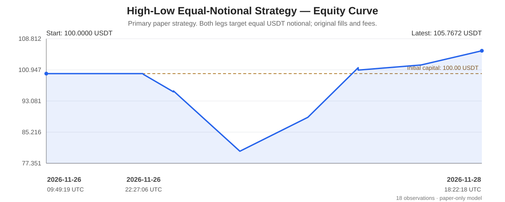

# ACTIVE PAPER STATUS — BAB $100 USDT

**🟢 ACTIVE · PAPER ONLY · NO LIVE ORDERS**

**Correct workflow:** [Open active workflow](https://github.com/takenthatusernameis-collab/Crypto-Betting-Against-Beta/actions/workflows/bab-paper-cycle.yml)

- Account: `mexc-usdt-forward-bab-100usdt-v1`
- Strategy generation: `crypto-bab-low-beta-long-high-beta-short-v1`
- Starting capital: **100.00000000 USDT**
- Account state: **INITIALIZED — FORWARD PAPER**
- Last report build: 2026-11-26 22:22:46 UTC
- Latest workflow run: [45904294165](https://github.com/takenthatusernameis-collab/Crypto-Betting-Against-Beta/actions/runs/45904294165) · run #11, attempt 1 · success · push
- Latest processed daily candle: —
- Latest account event: 2026-11-26 22:22:23 UTC
- Primary execution journal: [PAPER_TRADE_JOURNAL.md](PAPER_TRADE_JOURNAL.md)

## MEXC market-data coverage

- Coverage state: **READY**
- Active cross-margin contracts: —
- USDT-settled eligible contracts: not refreshed in snapshot mode
- New histories completed this run: 0
- Histories remaining: not refreshed in snapshot mode
- API failures: 0
- Latest completed daily bar (UTC ms): 1795564800000
- Portfolio decision status: `RETRY_PAIR_REBUILT`

Portfolio changes remain blocked until the full active cross-section has the required current daily history.

### Provisional BAB ranking preview

Not execution-approved until full-universe coverage passes.

**Lowest-beta long candidates**

**Highest-beta short candidates**
## Current performance

| Metric | Value |
|---|---:|
| Initial capital | 100.00000000 USDT |
| **NAV** | **99.86839680 USDT** |
| Total return | -0.132% |
| Cash | 99.96939680 USDT |
| Unrealized P&L | -0.10100000 USDT |
| Fees paid | 0.03060320 USDT |
| Confirmed funding | +0.00000000 USDT |
| Gross exposure | 1.533× NAV |
| Net exposure | 0.370× NAV |
| Current drawdown from risk-window peak | +0.000% |
| Lifetime / cross-session maximum drawdown | +0.000% |
| Worst risk-session maximum drawdown | +0.000% |
| Sharpe ratio | Unavailable — sample gate not met |
| Sortino ratio | Unavailable — sample gate not met |
| Annualized daily volatility | Unavailable — sample gate not met |

### Maximum drawdown by risk session

| Session start (UTC) | Starting NAV | Latest NAV | Max drawdown | Marks |
|---|---:|---:|---:|---:|
| 2026-11-26 00:00:00 UTC | 100.00000000 | 100.00000000 | +0.000% | 9 |

## Open positions

| Symbol | Side | Quantity | Entry price | Mark | Notional (USDT) |
|---|---|---:|---:|---:|---:|
| SOXS_USDT | long | 1 | 58.09 | 58.08 | 58.080000 |
| USELESS_USDT | short | 1300 | 0.07302 | 0.07309 | 95.017000 |

## Primary path — equal exposure

The live forward-paper strategy sizes the long and short legs independently toward equal USDT notional (approximately 1× NAV per leg before lot rounding).

## Alternative path — volatility-weighted sizing

This chart is a **visual-only counterfactual**, not an executed account. It reuses the primary strategy’s exact selected symbols, sides and rebalance timestamps; only the notional split changes. No alternative trade journal is created.

At each rebalance, the quieter leg receives the larger share using inverse 30-completed-day realized volatility. The leverage overlay is the ratio of equal-exposure pair volatility to the inverse-volatility pair’s base estimated volatility. It increases modeled gross exposure only when the alternative has lower estimated volatility. Estimates use only data available at that rebalance.

- Latest long / short allocation: **39.6% / 60.4%** of alternative gross notional.
- Latest volatility-matching leverage multiplier: **1.054×**.
- Estimated base volatility reduction before leverage: **+5.13%**.
- Volatility observations used: **30**; status: `RISK_MATCHED_INVERSE_VOLATILITY`.

**Model limitations:** the counterfactual scales observed primary entry/exit fees and funding by shadow notional. It does not model additional nonlinear market impact, depth constraints, liquidation limits or exchange leverage caps for larger hypothetical exposure. It is not an executable leverage recommendation.

## Next workflow action

The latest completed UTC daily candle is waiting for full-universe history coverage; no portfolio decision has been consumed.

The daily-candle watermark is not advanced by this report. Only the paper workflow can consume a completed candle after full-history and execution gates pass. A blocked or incomplete run remains visible.

## Historical separation

The v3 $50 USDT generation and its preliminary snapshots are archived and excluded from this account’s NAV, returns, equity curves and metrics. The immutable event ledger remains intact.

## Alternative-path reconstruction notes

- No reconstruction warnings.

This is the compact live status page. The former detailed v3 report is retained under `archive/2026-11-18/` for audit purposes only.
